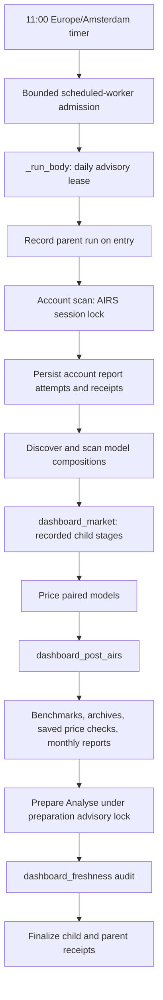
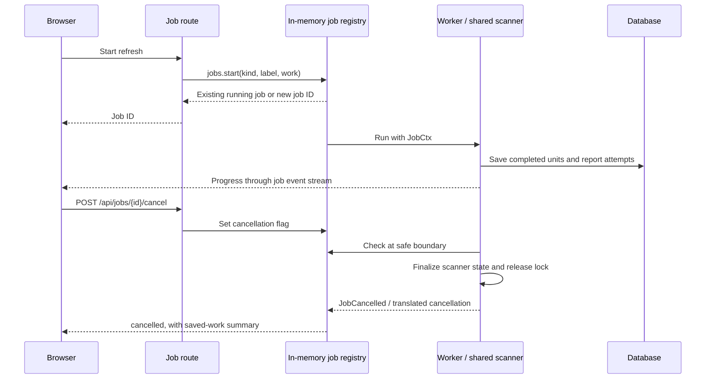
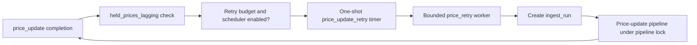

# AIRS and scheduler execution paths

This map explains where orchestration lives before changing it. Follow links to
functions rather than relying on line numbers. Operational recovery belongs in
[Troubleshooting](troubleshooting.md); timers and switches are in
[Scheduler](scheduler.md) and [Environment setup](environment.md).

## Entry points and ownership

| Entry | Dispatch / worker | Result ownership |
| --- | --- | --- |
| AIRS daily timer | `register_scheduler` → `_fire_airs_vermogen` → `_spawn_body` → bounded executor → `_run_body('airs_vermogen_refresh')` | Scheduled parent and child receipts in `scheduled_job_run`. |
| Scheduled job “Run now” | `POST /api/admin/scheduled-jobs/{job_id}/run` → `start_job_now` → `jobs.start` → `_run_body(job_id, ctx, triggered_by='manual')` | Same scheduled body/receipts as timer, plus an in-memory cancellable job. It does not enter through the timer's bounded executor. |
| Dashboard AIRS account refresh | `POST /api/airs/vermogen/refresh/job` → `jobs.start` → `services.airs_refresh.refresh_accounts` → shared account scanner | In-memory job progress plus scanner persistence. This is not the daily sequence wrapper. |
| Dashboard single account refresh | `POST /api/airs/portfolios/{portefeuille}/refresh/job` → `jobs.start` → `services.airs_refresh.refresh_account` → `refresh_portfolio_fully` | Account/dependent-account results; service applies `job_verdict` for busy/cancel/failure outcomes. |
| Model-composition refresh | `POST /api/airs/model-portfolios/scan/job` → `scan_models` → shared `collect_model_compositions` | Model composition persistence and job progress; separate from the account refresh job. |
| Performance opening | Account performance route → `prepare_performance` → `_prepare_performance` | Can prepare/persist missing historical reports before returning the bundle. It is not always a read-only request. |

Source: [scheduler.py](../backend/scheduler.py), [admin routes](../backend/routers/admin.py),
[AIRS routes](../backend/routers/airs.py), [jobs.py](../backend/jobs.py),
[monthly reports](../backend/routers/_airs_monthly_report.py).
The dashboard UI may chain account and model jobs; do not assume that one route
performs every step of the daily scheduler sequence. Legacy plain POST/SSE
routes also exist: inspect their handlers before modifying a shared scanner.

Refresh workers live in [services/airs_refresh.py](../backend/services/airs_refresh.py).
Manual and scheduled callers share `scan_accounts`, `collect_model_compositions`,
and `price_models`; adapters keep their force/scope, progress and cancellation
policies. Price/risk/benchmark job workers live in
[services/airs_market_jobs.py](../backend/services/airs_market_jobs.py).
The HTTP handlers keep endpoint declarations, validation, job identity and
response envelopes. Scheduler dispatch delegates daily sequencing, admission,
lease acquisition and run recording to the modules below. Existing collectors under
`routers/_airs_*` remain domain dependencies; this extraction does not move
their response models or rewrite the scanner.

The scheduler now delegates those responsibilities to explicit owners:
[admission](../backend/scheduler_runtime/admission.py),
[recorded execution](../backend/scheduler_runtime/execution.py),
[held-price retry policy](../backend/scheduler_runtime/retries.py), and
[watchdog recovery](../backend/scheduler_runtime/recovery.py).
Daily sequencing lives in [AIRS jobs](../backend/scheduler_jobs/airs.py);
[market jobs](../backend/scheduler_jobs/market.py) and
[preparation jobs](../backend/scheduler_jobs/preparation.py) own their stages.
Automatic price checks have their own narrow
[single-flow module](../backend/scheduler_jobs/price_checks.py), shared by timer
and manual dispatch under the same job ID.
`scheduler.py` supplies dispatch callbacks through `JobRuntime`; job modules
do not import the dispatcher or create another body registry.

## Daily AIRS sequence

The sequence is owned by `_body_airs_vermogen`, not by the router. Worker
admission rejects duplicate/live jobs and over-capacity ticks instead of
building an unbounded queue. `_spawn_body` records missed work when appropriate.
Admission failure happens before a normal body receipt starts.

`_run_body` takes `daily_lease` for the daily parent, `dashboard_market`, and
`dashboard_post_airs`. Nested child calls share the context's lease rather than
trying to reacquire it. Automatic AIRS attempts are checked against that
Amsterdam day's receipts; explicit manual retries are separate.

`services.airs_refresh.scan_accounts` delegates to `run_airs_vermogen_refresh_sync`,
which discovers portfolios, selects accounts using
scope/freshness/force settings, downloads/parses reports, and saves attempts and
per-account completeness. The daily wrapper uses dashboard scope and forces
the scan. The browser/session lock is released by the scanner's `finally`;
it is not held throughout later market-data and preparation stages. Both manual
and daily model scans use `collect_model_compositions`, which owns the session
lock around discovery, roster persistence and composition counting. Manual
repair defaults to missing compositions and a nonblocking lock attempt; the
daily sequence forces all scoped compositions and waits up to 60 seconds.

Independent stages can continue after a failure, retaining its evidence.
A busy AIRS session is an early failure, not permission to run a second scan.
Other branches and cancellation can also stop the path; the diagram is the
normal order, not a promise that every box executes on every outcome.

`dashboard_market` runs FX, asset prices, benchmarks, and due fundamentals via
recorded child jobs. `dashboard_post_airs` prepares monthly benchmarks and
year-end archives, saves checks, builds months from stored sources, downloads
dated AIRS reports when needed, prepares Analyse, and audits freshness even
when preceding preparation failed.

Source: [daily lease and stored preparation](../backend/dashboard_daily.py),
[account scanner](../backend/airs_vermogen.py),
[job declarations](../backend/scheduled_jobs.py).

## Manual refresh and cancellation

`jobs.start` reuses work by `(kind, label)` within the process. This is not a
cross-replica lock. `GET /api/jobs` and the stream let the browser reattach;
closing a tab or losing the stream does not cancel the worker.

The AIRS fleet scanner checks `should_stop` between accounts and finalizes its
own state before returning `cancelled_at`. The route must raise `JobCancelled`
for that outcome: returning a “Cancelled…” string would mark the job `done`
and could allow a UI's next phase to start. A completed account's report
attempts remain saved; this is not one database transaction for the whole fleet.

For scheduled bodies, `_Cancelled` is caught inside `record_run`, the durable
status becomes `cancelled`, then the wrapper raises `jobs.JobCancelled` for the
manual job transport. Do not move that catch outside the recording context.
Not every operation has an immediate cancellation boundary.

Source: [job transport routes](../backend/routers/jobs.py),
[registry and JobCtx](../backend/jobs.py), [scheduled wrappers](../backend/scheduler.py).

## Locks and persistence boundaries

| Guard | Scope / owner | Preserve when editing |
| --- | --- | --- |
| Scheduled capacity slots and live-future map | Process-local; `_submit_scheduled_work` | Release on submission failure and completion; keep separate maintenance capacity. |
| `bbterminal.dashboard_daily` advisory lock | Cross-process database session; `daily_lease` | Nested lease reuse, release in `finally`, automatic-day attempt gate. Unknown lock state must not permit work. |
| AIRS `_LOCK` | Process-local browser session; `airs_vermogen` | Busy result, safe cancellation boundaries, release in `finally`. Review every direct scanner caller. |
| `bbterminal.analyse_prepare` advisory lock | Cross-process database session; `run_controlled` | Defer while sources are busy; never publish a snapshot as current if source/code changed during calculation. |
| `_PIPELINE_LOCK` | Process-local ingestion pipeline | Serialize price-update/rebalance operations; release after the operation. It is not the daily advisory lock. |
| Monthly `_PREPARATION_LOCKS` | Process-local striped locks in `_airs_monthly_report` | Serialize Performance preparation by account; collisions may serialize unrelated accounts. Dated downloads also use the AIRS lock. |

Scanner writes include holdings, performance, transaction snapshots, roster and
report-completeness state. Monthly collection stores an isolated
`airs_monthly_report` bundle before reporting missing position returns; it must
not replace live holdings/performance with historical data. Analyse publishes
`analyse_prepared_snapshot` with source revision, code version and calculation day.

Scheduled run recording is best-effort bookkeeping: failures to save a receipt
are logged and must not undo real work. Parent/child receipts are separate;
there is no all-or-nothing transaction covering a whole refresh.

Source: [run recording](../backend/job_runlog.py),
[Analyse preparation](../backend/routers/_prepared_analyse.py),
[pipeline lock](../backend/ingest/phases/pipeline.py).

## Failure and retry flow

| Outcome | Reporting path |
| --- | --- |
| Expected partial monthly report | Persist bundle → `UserFacingJobError` with position/source evidence → failed user job, or warning during Performance preparation. Saved partial data remains available. |
| Incomplete scheduled stage | Raise `IncompleteRefresh(message, summary)` → `_run_recorded_body` preserves structured summary → run recorder finalizes failure → parent retains nested evidence. |
| Unexpected user-job exception | Registry marks `failed` and emits a shortened diagnostic; detailed evidence should be persisted before raising when needed. |
| Cancellation | Explicit cancelled outcome; preserve completed writes and release owned guards. |
| Source unavailable or deferred | Keep stale/missing state visible. “No exception” or “HTTP 200” does not imply current data. |

Automatic held-price recovery follows a separate path:

`maybe_schedule_price_retry` defaults to a 3-hour delay and 3 retries per UTC
day; its counters are process-local. It replaces the pending one-shot timer.
It checks active strategy-held price lag, not every dashboard instrument.
Provider throttling has its own process-local Yahoo circuit; deferred
instruments and failed writes must remain in receipts. Do not add an outer
retry that multiplies these attempts or bypasses the provider circuit.

Before extracting code, preserve the existing entry point, guard scope,
cancellation boundary, write ordering, and failure receipt. Verify these with
unit fakes; follow [Testing](testing.md) for the project's test policy.
